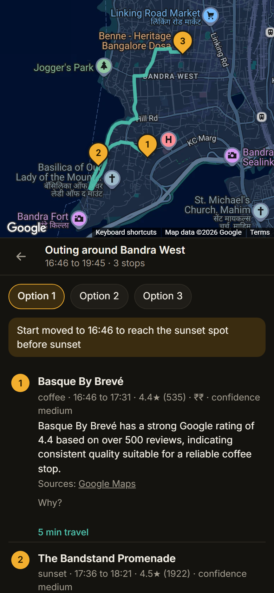
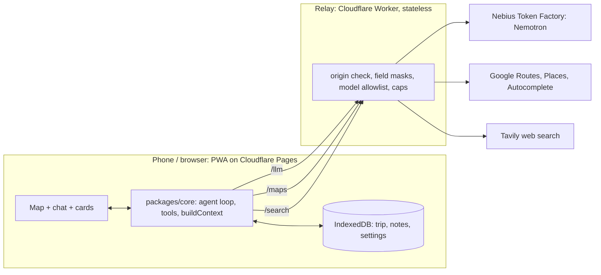

# Trippy

Trippy is an AI decision layer on top of Google Maps data, for passengers in India. You say what the car needs ("dad is hungry, something like Domino's within 20 minutes", in English or Hinglish). Trippy finds real places along your route, checks live travel times and opening hours, weighs the trade-off for your group and shows the best three on a map with a short reason for each. It also plans outings before you leave. It is not a navigation app: Google routes, Trippy decides.

- Live app: https://trippy-c20.pages.dev (no key or sign-in needed)
- Video: https://youtu.be/I10ptoImWnY
- Built for the Nebius x NVIDIA Global AI Hackathon, track Best Apps and Agents. Models: NVIDIA Nemotron 3 (Nano, Super, Ultra) on Nebius Token Factory.
- Team: Shreyas Bhat ([DarthRoco](https://github.com/DarthRoco)) and Shruti Prakhya ([wannabe-yoda](https://github.com/wannabe-yoda)).
- History: this repo was started fresh when the project was renamed to Trippy on 29 October 2026. The work from 1 to 29 October (pull requests, design notes, test logs) lives in our private working repo; the code here is the same.



## Try it (for judges)
You do not need to be in Mumbai or in a car.

1. Open https://trippy-c20.pages.dev. On a phone, add it to the home screen to install it.
2. Type a start and a destination and pick both from the suggestions. A tested pair: **Kurla West** to **Domino's Pizza, Juhu Beach**. Tap **Start trip**. If the trip is long, a banner offers to look for something closer.
3. Tap the play button in the trip bar (**Replay this drive**). The app then drives the route on a simulated GPS trace, ten times faster than real time, and uses live Google data around the replayed position. (On the landing screen the same thing is **Replay a drive**, once a trip exists.) The trace is simulated along Google's route, not a recording of a real drive.
4. While it plays, ask for things. These worked in our tests:
   - `Veg place within 10 min`
   - `Something like Domino's, max 10 min detour`
   - `Headed to Domino's Juhu, 1.5 h traffic, find similar places on the way, within 15-20 min, dad is angry`
   - `bhai jaldi koi veg place batao 10 min mein`
   - `Nearest ATM on the way`
   - `Bhai chai break kahan milega?`
   - `We leave at 7 pm for Trishna, is that a bad idea?` (a later departure, checked with traffic-aware routing)
   - `Tyre punctured, anywhere nearby to fix it?`
   - `Accident, dad is hurt` (shows a 112 button at once, then looks for a hospital)
5. Then follow up: `Is the second one pure veg?`, `Tell me more about the second one`, `Is it actually famous?` (web search), `Will it be open when we get there?`. Tap a card, then **Add stop**: the map previews the route through the place with "+N min", and **Confirm** puts it in the plan.
6. Tell it a fact: `dad is vegetarian`. It is remembered for this trip. Say `Mom is allergic to seafood, always remember that for every trip` and it goes on your profile for every trip (Profile screen).
7. Open **Settings** and switch on **Show how Trippy decided**. Each answer then shows which models ran, which tools were called, how many places were considered against how many shown, and the time taken.
8. Go back to the landing screen and tap **Plan an outing**. Pick an example or write your own, for example `Dinner at Toit at 8 pm in Indiranagar, a walk and a coffee before that`.

## What it does
- Reads a request in English, Hindi or Hinglish and calls tools. The tools are code; the model only asks for them.
- Finds places along the route, drops places that are closed now, ranks by rating, review count and detour time, and shows three with short reasons. Reasons may use only what the data holds; code blanks claims the place name does not support.
- Checks times in code: ETA from the car, a later departure with forecast traffic, a flight or train deadline measured to the airport or station with a buffer (90 min for a flight, 20 for a train).
- Keeps the trip: stops you add, notes ("grandma is with us"), searches and chat, on the phone. Real stops are logged when the car stands still within 150 m for 4+ minutes.
- Follows the car on the map, with a re-centre button. Older answers fold to one-line cards.
- Shows banners for a long ETA at the start and for an ETA jump mid-trip. Detects off-route and recomputes.
- Opens a place in Google Maps or Uber, or shares it on WhatsApp.
- Plans outings: a timed plan from real places, checked against opening hours, travel times and sunset.

## Architecture

- **PWA** (`apps/web`): Vite, React, TypeScript, vite-plugin-pwa, `@vis.gl/react-google-maps`. Hosted on Cloudflare Pages.
- **Agent in the browser** (`packages/core`): the loop, the tool schemas and their code, the context builder and the provider interface all run on the phone. Every turn calls a tool (`tool_choice: required`), up to four rounds, and the last round forces a reply. Tools: `find_stops`, `place_details`, `eta_from_here`, `web_search`, `make_link`, `remember`, `forget`, `get_trip_state`, `end_trip`, `reply`.
- **Provider interface**: the map data sits behind one interface (`MapProvider`). Google is the only implementation.
- **Relay** (`apps/proxy`): a stateless Cloudflare Worker with three routes, `/maps` (Google key), `/search` (Tavily key) and `/llm` (Nebius key). It holds the keys, checks the origin, allows only listed Google field masks and listed models, and counts calls against caps. Daily counters live in a Durable Object.
- **Rules the design holds to**: the model never invents places (every suggestion is a real Google result); code writes all state (the model changes state only through `remember`, `forget` and the `save` field of a search, which code filters); every Places call uses a field mask with only the fields needed.

## Models
All models run on Nebius Token Factory (OpenAI-compatible API) through the relay. The trip agent's config is one object, `MODELS` in `packages/core/src/llm.ts`. The outing planner has its own, `PLANNER_MODELS` in `packages/core/src/planner/model.ts`.

| Job | Model | Reasoning |
|---|---|---|
| Read the request, pick the tool (trip agent) | `nvidia/nemotron-3-super-120b-a12b` (Super) | off, about 1.5 s |
| Rank the real places and say why | `nvidia/Nemotron-3-Ultra-550b-a55b` (Ultra) | off |
| Planning questions (sights near the destination, places off the urgent path, empty searches); nobody is waiting | Ultra | on, up to 8192 tokens |
| Read an outing request into fields (planner) | `nvidia/NVIDIA-Nemotron-3-Nano-30B-A3B` (Nano) | off |
| Read web evidence, write one-line reasons (planner) | Super | off |

Why these: in our day-1 tests Nano picked the right tool 3 times in 6 and Super 6 in 6, so Nano stays out of the trip agent. Super invented facts when ranking; Ultra gave grounded reasons. A user can paste their own OpenAI-compatible key in Settings; calls then go straight from the phone to that provider (the planner does not use it).

## Privacy
- Your trip, chat, notes and settings live on your phone, in IndexedDB. There are no accounts and no database on the server.
- The relay passes requests through. The code stores and logs nothing, and keeps only call counters for the caps.
- What leaves the phone: your messages and a short summary of the trip go to Nebius for the model call; place searches, routes and your position go to Google; follow-up web searches go to Tavily. All three go through the relay, which keeps the keys.
- Caps per day, across all users / per session: maps 2000 / 400, autocomplete 5000 / 300, llm 3000 / 200, web search 200 / 20, planner web evidence 100 / 30. Over a cap the relay answers 429.
- The only key in client code is the browser map key, restricted by website. The debug log (Settings -> Export debug log) stays on the device until you export it.
- Your own key, if you add one, is saved on the phone and sent only to the provider you named.

## How it was tested
- **Test requests**: the test set (`packages/core/src/testset.run.ts`) holds 71 requests the agent must handle: rescue, follow-ups, memory, planning, emergencies and absurd asks. The first 30 ran on three routes in Mumbai, three times each, with the real models (89 to 90 of 90 after fixes). Failures became fixes and then new cases.
- **End-to-end flows**: ten long trip flows across five cities (Mumbai, Delhi, Bengaluru, Kolkata, Hyderabad) in real browsers, with fake GPS and fast replay. A script checks the saved trip document, places, buttons and answer times at every step; a reviewer reads the rest. Two full runs on the live site on 10 October found 11 and then 12 real bugs. Each became a test request and a fix.
- **Offline checks**: `npm run check` runs 13 check scripts with no network (geometry, context, time and deadlines, agent guards, relay guards, and eight for the planner, including 28 recorded searches that must give the same plans).
- **A real ride**: on 18 October Shreyas rode from Nashik to Navi Mumbai (about four hours) with Trippy open and asked 28 questions. Shruti compared the debug export and GPS tracks with the code and found 11 problems plus 6 more in the log. We fixed them all: a stale ETA banner, old minutes quoted as current, a flight check measured to the hotel instead of the airport, picks behind the car listed first, two-wheeler garages for a car, "Failed to fetch" shown as a reply, "end here" that did not end the trip, no way to see the car on the map, and real stops missing from the trip. The same ride gave a comparison with Google Maps and Gemini (see below).
- **Planner**: golden checks hold the TypeScript planner to the answers of its first Python version; the request reader scored 19 of 20 on the original set and 36 of 36 on 12 new requests.

Where Trippy differed from Google Maps and Gemini on that ride: for tea, Google Maps showed a place behind the car and Trippy one on the way; for toilets Google Maps listed places in a radius, while Trippy said none were on the route; for "garage" Google Maps showed two-wheeler garages and Trippy a four-wheeler service centre; Gemini kept no memory between questions. Google Maps shows much more map detail than Trippy.

## Honest limits
- A PWA gets no GPS in the background. Trippy tracks the car only while it is open on screen (it asks the phone to keep the screen on during a trip). When you come back to it, it refreshes position and route at once. Background alerts would need a native app.
- Google data only. Ratings and opening hours are Google's. Table waits, rupee prices (Google gives a 0 to 4 scale, shown as rupee signs) and washroom cleanliness are not in any source, and Trippy says so.
- India-focused. Autocomplete is limited to India and biased to Mumbai. The tests are in five cities, the real ride in Maharashtra.
- Trippy cannot change a running Uber ride. It opens Uber or Google Maps so you can.
- The replay uses a simulated trace, not a recording of a real drive.
- Daily caps are shared by all users and are small. If a judge sees "daily limit reached", the cap is spent for the day; the own-key option in Settings avoids the relay for trip questions.
- Google's "metro" label also covers some suburban rail stations. Trippy repeats it.
- No voice input yet. The model can still pick a wrong tool or skip saving a fact now and then: in one of three late F1 runs it did not save "dad is vegetarian".
- Google Maps Platform terms limit caching of places content. Trippy keeps place facts on the phone with the trip and deletes them when you end it (the on-device debug log keeps a copy of the last five trips until you clear the site data).

## Run locally
Needs Node 22+. Put keys in `.env` at the repo root (names in `.env.example`).

```
npm install
npm run dev:proxy   # backend on :8787 (holds the keys)
npm run dev:web     # app on :5173
```

`npm run check` runs the offline checks. `node packages/core/src/testset.run.ts` runs test requests through the model (needs the proxy, costs tokens).

## Outing planner
The second option on the landing screen: "Plan an outing". Describe an outing ("3 hours on Sunday afternoon in Indiranagar: coffee, a quiet place to work, then sunset") and get up to three timed plans from real places, with opening hours and travel times checked in code. "Start this outing" opens a plan as a normal Trippy trip. It lives in `packages/core/src/planner` and `apps/web/src/Planner.tsx`.

- Stop types include a shopping stop ("a statement ring") and places you name. A named place is fixed at the time you give, and the start is worked back from it ("dinner at Kopitiam Lah at 7 pm, a ring before that").
- If you ask for something it cannot plan yet (a movie), it says "I can't plan X yet" and plans the rest.
- Reasons that only hold on other weekdays or other hours are filtered out in code.
- The Area field gives Google place suggestions as you type.
- `npm run check:planner` runs its offline checks. `search.check.ts` replays 28 searches recorded from the original Python planner (`golden.json`, place names and ids replaced) and must return the same plans.
- Add `?noweb` to the address to plan without web evidence (no Tavily calls), for test runs.

## End-to-end tests
`npm run e2e` drives ten long trip flows (`tests/e2e/flows.ts`) in real browsers, one browser context each, in parallel. It costs model and Maps calls, so run it only on purpose.
First time: `npx playwright install chromium`. Pick flows by id: `npm run e2e -- F1 F10`.

```
npm run e2e                          # all ten, against the live site
npm run e2e -- --local=5174 F1 F10   # localhost (web app on 5174 and npm run dev:proxy running), two flows
```
Other flags: `--url=<site>`, `--chrome` (installed Chrome), `--headed`. Results go to `test-results/e2e/<time>/`: `summary.json` (every code check, the judge notes for a reviewer), and per flow each step's screen text, screenshot and trip document plus the flow's debug log. Flows are data in `tests/e2e/flows.ts`, helpers in `tests/e2e/lib.ts`. The exit code is 1 when a code check failed.

## Deploy (Cloudflare, free plan)
- App (Pages project `trippy`, direct upload): https://trippy-c20.pages.dev. Build with `VITE_PROXY_URL=<the Worker URL> npm run build -w apps/web`, then from `apps/web`: `npx wrangler pages deploy dist --project-name trippy --branch main`. Another `--branch` gives a preview URL (`https://<branch>.trippy-c20.pages.dev`).
- Proxy (Worker `trippy-proxy`): https://trippy-proxy.trippy-app.workers.dev, config in `apps/proxy/wrangler.toml`, entry `apps/proxy/src/worker.ts` (wraps `handler.ts`). Deploy from `apps/proxy` with `npx wrangler deploy`.
  Secrets live only in Cloudflare (Worker -> Settings -> Variables and Secrets): `NEBIUS_API_KEY`, `GOOGLE_MAPS_SERVER_KEY`, `TAVILY_API_KEY`.
  Allowed web origins are `ALLOWED_ORIGINS` in `wrangler.toml` (a `https://*.host` entry also accepts preview subdomains).
  Daily caps are counted in a Durable Object (`Caps` in `worker.ts`), so they survive restarts.
- Both deploys need `npx wrangler login` once. The local Node proxy (`npm run dev:proxy`) stays for development.
- Google Cloud: the browser key's website restrictions must list `https://trippy-c20.pages.dev/*` and `https://*.trippy-c20.pages.dev/*`.

## Layout
- `packages/core`: tools, map provider, agent loop, model config, outing planner
- `apps/proxy`: stateless backend (`/maps`, `/search`, `/llm`); stores and logs no user data
- `apps/web`: the app (Vite + React)
- `tests/e2e`: the end-to-end runner and its flows

## License
MIT
